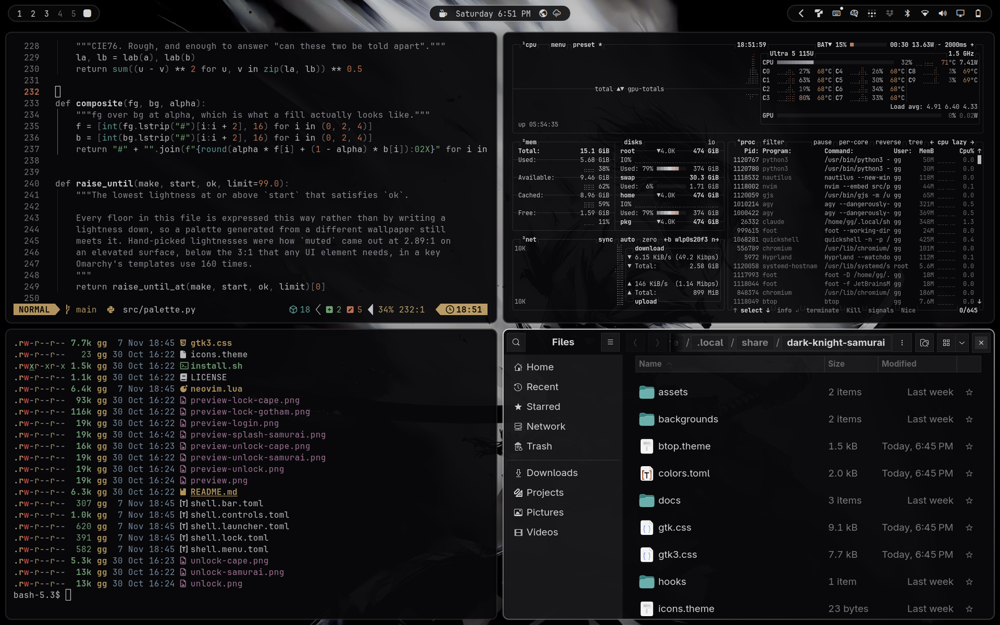
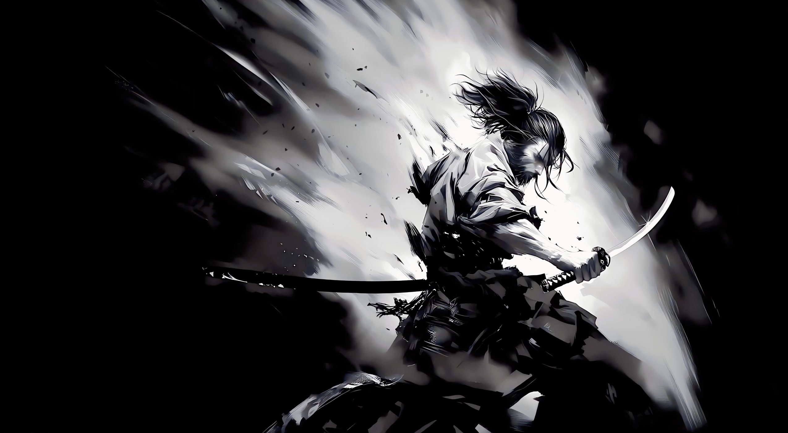
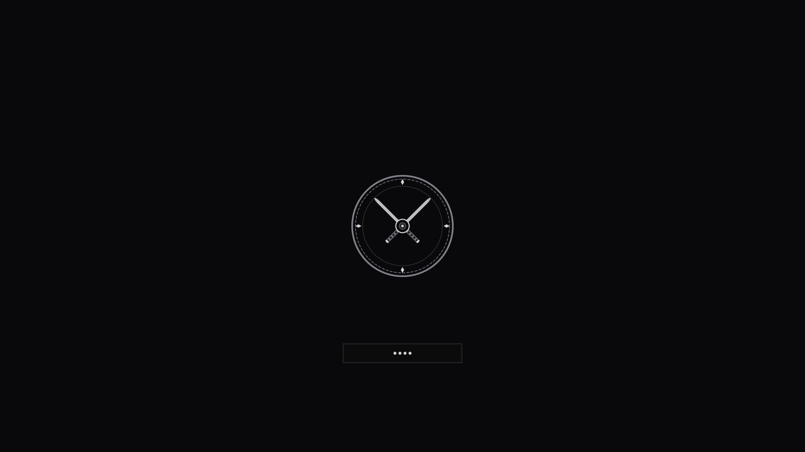

# Dark Knight Samurai

A Japanese ink-wash & Katana Steel theme for [Omarchy](https://omarchy.org).



Obsidian ink and folded katana steel with specular silver reflections.
The monochromatic palette is tailored directly for the Samurai sumi-e artwork.

## Preview

| Wallpaper | Boot and disk-unlock screen |
|---|---|
|  |  |

Samurai features an ink-wash / sumi-e artwork paired with an authentic Japanese crossed-katana Kamon crest on `#09090B` obsidian ground.

## Install

```sh
git clone https://github.com/itsgg/omarchy-dark-knight-samurai-theme.git ~/.local/share/dark-knight-samurai
bash ~/.local/share/dark-knight-samurai/install.sh
```

The installer applies the full theme, including Neovim syntax colours and
indent guides. It links this working copy into Omarchy and preserves any
previous install in `~/.local/state/dark-knight-samurai/backups/`. Keep the checkout
in place. Running the installer again is safe.

Switch back to it later with `omarchy theme set "Dark Knight Samurai"`.

Optional:

```sh
# GTK apps and the file chooser follow the theme
omarchy hook install theme-set ~/.config/omarchy/themes/dark-knight-samurai/hooks/gtk-follow-theme

# Boot and disk-unlock screen (asks for your password, rebuilds the initramfs)
bash ~/.config/omarchy/themes/dark-knight-samurai/src/install-splash.sh samurai

# SDDM login screen
bash ~/.config/omarchy/themes/dark-knight-samurai/src/install-login.sh
```

## Palette

| Key | Hex | Use |
|---|---|---|
| `background` | `#09090B` | obsidian sumi-e ink ground |
| `lighter_background` | `#18181B` | folded steel raised surfaces |
| `line` | `#27272A` | rules, guides, inactive border |
| `muted` | `#80808A` | comments, line numbers |
| `foreground` | `#D4D4D8` | katana steel body text |
| `accent` | `#E4E4E7` | specular katana blade reflection, focus |
| `active_border` | `#D4D4D8` | focused window specular edge |
| `red` | `#D9534F` | vermilion / cinnabar lacquer |
| `orange` | `#C87A5B` | |
| `yellow` | `#C8A86B` | gold ochre / tsuba |
| `green` | `#7DAF82` | bamboo |
| `cyan` | `#68A8A5` | celadon |
| `blue` | `#8599B2` | slate steel |
| `magenta` | `#B382A8` | plum / wisteria |

## What is included

Everything Omarchy generates from `colors.toml` (terminals, Hyprland, the
shell, Chromium, VS Code, Obsidian), plus:

| File | |
|---|---|
| `backgrounds/` | Samurai sumi-e wallpaper |
| `shell.*.toml` | bar, launcher, menu, lock card, control states |
| `neovim.lua` | quiet indent guides, syntax colour kept for data |
| `gtk.css`, `gtk3.css` | libadwaita and the GTK3 file chooser |
| `btop.theme` | monochrome meters |
| `unlock.png` | Samurai Kamon Plymouth splash asset |

## Development

```sh
src/render.sh                          # theme files and previews
src/preview.sh                         # retakes preview.png
python3 -m unittest discover -s tests -v # checks suite
```

## License

MIT. See [LICENSE](LICENSE).
